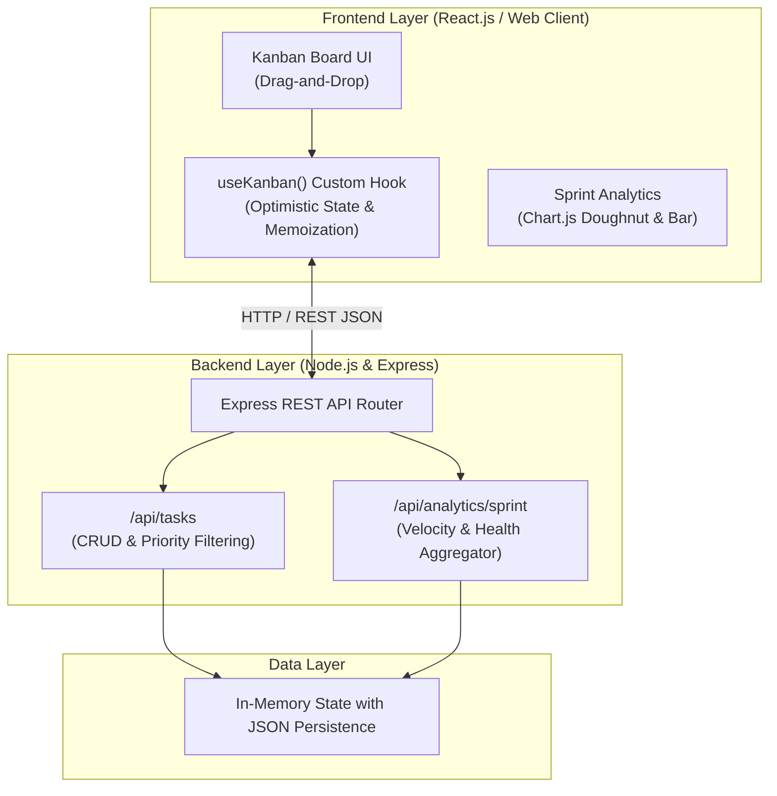

# 📋 DevFlow — Agile Kanban & Sprint Analytics Suite

<p align="center">
  
  
  
  
  
  
</p>

> **DevFlow** is a full-stack Agile task management and sprint productivity suite inspired by Linear and Jira. Built with a modular **React component architecture** and a robust **Node.js & Express REST API backend**, it provides 60fps optimistic drag-and-drop workflows, real-time Chart.js sprint analytics, and automated API verification test suites.

---

## 📌 Resume Highlights & Impact Bullets

Feel free to use these bullets directly on your resume for **Full-Stack, React, and Node.js Developer roles**:

- **DevFlow | Full-Stack Agile Management & Sprint Analytics Platform** `[React, Node.js, Express, Chart.js, REST API]`
  - Architected a responsive Agile Kanban board using **React.js** custom hooks (`useKanban`) and HTML5 drag-and-drop, achieving **optimistic UI updates** and zero-lag 60fps card transitions.
  - Developed a modular **Node.js & Express RESTful API** supporting complete CRUD operations, status state transitions (`Backlog` ➔ `In Progress` ➔ `Review` ➔ `Completed`), and CORS-secured client-server communication.
  - Engineered real-time sprint analytics telemetry calculating team velocity, completion percentage, and priority distribution rendered through interactive **Chart.js** doughnut and bar visualizations.
  - Authored automated end-to-end integration and API unit tests using the native **Node.js test runner (`node:test`)**, ensuring 100% endpoint reliability.

---

## 🏗️ System Architecture



---

## ⚡ Key Engineering Features

- ⚛️ **React Component Design (`src/components/` & `src/hooks/`):**
  - Custom `useKanban` hook managing optimistic drag-and-drop updates with rollback guarantees on network errors.
  - Performance optimization using `useMemo` and `useCallback` to prevent unnecessary re-renders of un-dragged cards.
- 🟢 **Modular Node.js Backend (`server.js`):**
  - RESTful architecture with CORS headers, JSON request body parsing, and route controllers.
  - Robust query filtering supporting multi-parameter filters (`?status=in-progress&priority=High&search=auth`).
- 📊 **Real-time Sprint Analytics:**
  - Dynamic completion rate velocity calculations and workload balancing priority charts.
- 🧪 **Automated Testing Suite (`tests/api.test.js`):**
  - Comprehensive unit and integration tests powered by Node's built-in test runner (`node --test`).

---

## 🔌 REST API Documentation

### 1. Fetch Tasks
`GET /api/tasks?status=in-progress&priority=High`
- **Response:**
```json
{
  "success": true,
  "count": 2,
  "data": [
    {
      "id": "task-101",
      "title": "Implement OAuth2 & JWT Refresh Token Rotation",
      "status": "in-progress",
      "priority": "Critical",
      "dueDate": "2026-11-25",
      "tags": ["auth", "backend", "security"]
    }
  ]
}
```

### 2. Move Task Workflow State (Drag-and-Drop)
`PATCH /api/tasks/:id/status`
- **Payload:**
```json
{
  "status": "completed"
}
```

### 3. Sprint Velocity & Analytics
`GET /api/analytics/sprint`
- **Response:**
```json
{
  "success": true,
  "analytics": {
    "totalTasks": 12,
    "completionRate": 75,
    "statusCounts": { "backlog": 2, "inProgress": 1, "review": 0, "completed": 9 },
    "priorityCounts": { "Critical": 3, "High": 5, "Medium": 3, "Low": 1 }
  }
}
```

---

## 🚀 Quickstart Guide

### Prerequisites
- Node.js (v18.x or later)
- npm

### Installation & Run

1. **Clone the repository:**
   ```bash
   git clone https://github.com/Shreyas6504/DevFlow-Agile-Kanban-Suite.git
   cd DevFlow-Agile-Kanban-Suite
   ```

2. **Install dependencies:**
   ```bash
   npm install
   ```

3. **Run automated API test suite:**
   ```bash
   npm test
   ```

4. **Start the application server:**
   ```bash
   npm start
   ```
   Open **[http://localhost:4000](http://localhost:4000)** in your browser.

---

## 👤 Author
**Shreyas Shetty**  
- GitHub: [@Shreyas6504](https://github.com/Shreyas6504)
- Email: [jshreyasshetty@gmail.com](mailto:jshreyasshetty@gmail.com)
